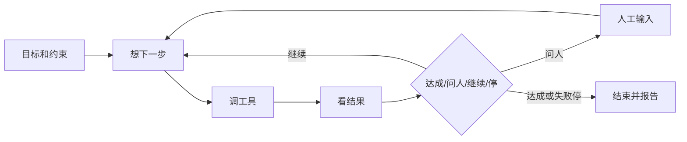

# Agentic Coding

Agentic Coding 指模型不只回一段文字，而是调工具、多步决策、改环境（代码库、终端、外部系统）把活干完。Flow、Prompt、Context、Harness、Spec 在这里会一起用到：Agent 越能动手，其它几项越不能空着。

## 一、核心概念

### 1.1 Chat 和 Agent 差在哪

| | Chat | Agent |
| --- | --- | --- |
| 输出 | 文本 / 代码片段 | 一串动作 + 环境真的变了 |
| 信息 | 主要靠你贴 | 能搜、读文件、跑命令、上网 |
| 节奏 | 人每轮推一把 | 在工具环里自己往前走（直到停） |
| 失败 | 你再问 | 有反馈时可以自己修（取决于外壳） |
| 风险 | 建议错了 | **错的也会写进系统** |
| 怎么评价 | 说得对不对 | 环境是否达到验收 |

Chat 关心回答好不好；Agent 关心状态有没有改到对。

### 1.2 简化的循环



工程上更该盯的，往往不是「让它更会想」，而是：工具对不对、观察靠不靠谱、有没有停止条件、权限和任务是否匹配。

### 1.3 单 Agent 和多角色


| | 好处 | 代价 | 适合 |
| --- | --- | --- | --- |
| 单 Agent | 简单、上下文连着、快 | 容易自我辩护；长线程易脏 | 目标清、范围小 |
| 多角色 | 职责分开，审查更狠 | 交接成本 | 跨模块、高风险、要先调研再动手 |

多角色有用，是因为目标和上下文不同，例如：

- 探索：只读，出影响面和风险，不改代码  
- 实现：只在允许路径里改，对照 Spec  
- 审查：以找问题为目标，不背「必须把功能做完」的压  

开两个窗口一起改同一目录，通常不算多角色，只是制造冲突。

### 1.4 工具和边界

| 工具 | 用处 | 风险 | 怎么收一收 |
| --- | --- | --- | --- |
| 读/搜 | 找现状 | 搜偏、断章取义 | 要证据；你点名权威文件 |
| 写文件 | 真正交付 | 越界、捏造 API | 限制路径、测试、人审 |
| 终端 | 验证、脚本 | 破坏性命令 | 审批、沙箱、拒绝列表 |
| 浏览器 | 看 UI / 文档 | 慢、不稳 | 限场景 |
| 外网搜 | 补文档、查报错 | 过时、乱引 | 关键以仓库为准 |
| MCP / 外部系统 | 连 Issue、设计、监控 | 凭证、误写 | 最小权限，能只读就只读 |

## 二、怎么做

### 2.1 非琐碎任务可以按这个顺序

1. 先有 Spec 或至少验收条目  
2. Ask / 只读摸清影响面  
3. Plan 定方案和切片  
4. Agent 在权限和测试反馈里实现  
5. 人审，或另开一个只负责找茬的审查  
6. 有用的约定写回 Rules / 文档；过期的删掉  

小活可以压成：Prompt 说清 + 必要文件 + 验收命令。

### 2.2 单 Agent 启动时可以带上这些

```text
目标：<...>
非目标：<...>
允许修改：<路径>
禁止：推远程、改密钥、路径外重构、新增依赖（除非先问）
参考：<文件>
验收命令：<...>
步骤：
  1) 复述目标和约束；有歧义先问
  2) 搜索并列出将要改的文件
  3) 小步改；能跑检查就跑
  4) 跑验收；失败就修或说明卡住原因
  5) 总结 diff 和风险
停止：
  - 验收过了
  - 或同一失败连续两次且没有新证据
  - 或必须突破允许路径（先问）
```

### 2.3 多角色怎么拆

探索（只读）：

```text
只读。输出：复述、相关文件、方案候选、风险、开放问题。
不要改文件。
```

实现：

```text
按定稿 Spec 和允许路径实现。
对不上先停。跑验收命令。
```

审查：

```text
目标是找缺陷，不是把功能做完。
按严重级别写：正确性 / 回归 / 安全 / 越界修改。
别直接大改；必要时给最小修复建议。
```

交接用 Spec、文件列表、决策记录，别让下一角色去考古长对话。

### 2.4 什么时候加角色、什么时候减

加：跨多个子系统；要先调研再动手；单 Agent 开始打转或自我辩护；支付、权限、删数据、安全一类高风险。  

减：已经精确到函数；纯文案配置；多角色协调成本比任务本身还高。

### 2.5 幻觉和越界怎么对付

| 现象 | 可以怎么做 |
| --- | --- |
| 捏造不存在的 API / 配置 | 要求先读再引用；测试红了；禁止无依据新增 |
| 改错文件 | 限制路径；先列文件再改；审 path |
| 顺手大重构 | 写清非目标；最小 diff；按片做 |
| 嘴上说测试过了其实没跑 | 要求贴命令输出 |
| 死循环修同一错 | 设停止条件；换证据；人介入 |

### 2.6 卡住时优先补哪块

| 现象 | 优先看 |
| --- | --- |
| 不知道该 Ask 还是 Agent | Flow |
| 做完了但对不对说不清 | Spec |
| 常改错模块、违反惯例 | Context |
| 意图清但还是出事或不稳 | Harness |
| 多步乱、角色打架 | 这篇的编排 |

## 三、常见坑

- 把 Agent 当无限实习生：没验收、没权限边界，越快越容易出事。  
- 伪多 Agent：多实例抢同一文件，没有交接物。  
- 以为同一会话越久越懂项目；经常是污染在累积。  
- 有浏览器/终端就默认全开。  
- Agent 说完成就当真，不去看环境和 diff。  
- 成功了也不把约定沉淀回去，下次还从零对齐。  
- 失败了只加长 Prompt 硬刚，其实缺的是证据、Spec 或权限策略。  
- 在脏工作区连续盲改：难 diff、难回滚、难归因。  
