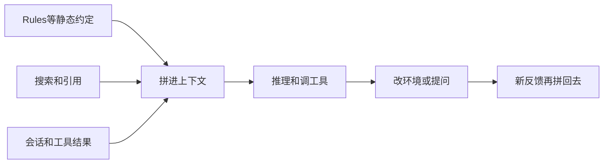
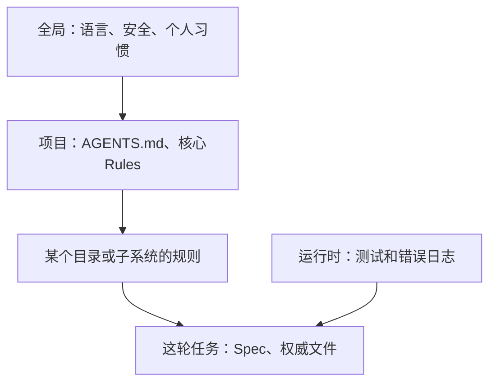

# Context 工程

Context 工程说的是：上下文窗口就那么大，这轮任务该让模型看见什么、别看见什么。Prompt 管「要什么」，Context 管「凭什么做」。很多时候，再多写两句 Prompt，不如把相关文件给对。

## 一、核心概念

### 1.1 它并没有「读过整个公司」

模型这一轮只能看见进上下文的东西（再加上训练里的先验）：

- 该看的文件没进来 → 只能猜，或拿过时记忆顶上  
- 无关文件塞太多 → 真正要紧的约束被冲淡  
- Rules 写错了还在生效 → 等于正式灌错误前提  

目标不是塞得越多越好，而是噪声少、有用信息够。

### 1.2 常见几类 Context

| 类型 | 例子 | 大概多久有效 | 容易出什么问题 |
| --- | --- | --- | --- |
| 代码 | 当前文件、@ 引用、搜索命中、diff | 短到中 | 选错文件、文件太大 |
| 约定 | Rules、`AGENTS.md`、Skills | 长 | 过期、互相打架、写太长 |
| 任务 | Issue、Spec、验收说明 | 中 | 和代码对不上 |
| 运行反馈 | 测试失败、lint、日志 | 短 | 日志太长淹掉关键几行 |
| 会话历史 | 同线程前后文、工具轨迹 | 短到中 | 错误假设被反复引用 |
| 外部 | 文档站、MCP、网页 | 短 | 过时、乱引 |

### 1.3 一轮大概怎么转



你能动的主要是：约定写什么、搜索范围多大、要不要重开对话、反馈怎么裁短。

### 1.4 「够用」怎么判断

这轮 Context 算够，大致要同时满足：

1. 能定位到该改的地方（或知道怎么搜到）  
2. 硬约束能遵守  
3. 能对照验收  

并且：去掉那些「看着有用其实无关」的大段之后，上面三点还成立。  
前三点不满足是给少了；去掉一堆噪声反而更好，是给多了。

## 二、怎么做

### 2.1 分层挂约定



| 层 | 适合写 | 别塞 |
| --- | --- | --- |
| 全局 | 语言、安全红线、稳定个人偏好 | 某个项目的 API 细节 |
| 项目 | 包管理器、目录怎么分、测试命令、禁止事项 | 过期架构长文 |
| 目录 | 这个子系统特有的约定 | 和全局对着干的「永远」 |
| 任务 | 本轮 Spec、照着写的文件 | 整仓粘贴 |
| 运行时 | 裁过的失败片段 | 未脱敏的完整生产日志 |

靠近任务的具体约定优先；全局只留真正全局的。发现冲突就改规则，别指望模型自己「聪明地和解」。

### 2.2 给材料的顺序

1. 先说清任务（目标 / 边界 / 验收）  
2. 让它搜索定位（符号、报错、路由名）  
3. 你点名权威文件（「照着 X 写」）  
4. 真正要用的再 @，别一上来塞十几个大文件  
5. 失败了喂相关错误段，别一次贴几千行日志  

「以防万一」把半个 `src/` 扔进去，通常适得其反。

### 2.3 仓库里留一点短地图

模型执行还行，每次从零猜项目结构就费劲。`AGENTS.md` 或短文档里写清：

- 目录大概谁管 UI / API / 领域逻辑  
- 怎么安装、启动、测、做类型检查  
- 改 API 要同步什么  
- 几条真正会导致事故的「别做」  

宁可一页正确的，不要二十页过期 wiki。

### 2.4 Rules / Skills 怎么写才有用

有用的规则一般是：能指导行动、违反了人看得出来、短、有人维护。

没用的通常是：互相矛盾的绝对句、「保持代码整洁」这类没法执行的话、从别处抄来和本仓无关的最佳实践。

Skills 更适合固化多步流程：发 PR、查 CI、发布检查、迁移步骤——固化步骤，不是固化口号。

### 2.5 日志和大文件先裁再喂

- 留：报错类型、第一条相关栈、失败断言、关键配置键  
- 删：重复重试、无关请求噪声、二进制、密钥  
- 大文件：只给相关函数，或先定位行号再读局部  

你自己都懒得读完的日志，丢给模型也很难稳定抽出信号。

### 2.6 会话什么时候该续、什么时候该开新的

| 情况 | 怎么处理 |
| --- | --- |
| 目标刚对齐 | 继续 |
| 刚做完一片 | 可以继续，但先写清下一片只做什么 |
| 理解从根本上偏了 | 新开，贴一段摘要 |
| 同一失败转了两三圈 | 停；换证据或收窄范围 |
| Rules 刚大改过 | 新开，避免旧解释还在 |

摘要可以很短：

```text
已确认目标：
已确认非目标：
已确认技术决策：
当前改动文件：
已知失败与原因：
下一步只做：
```

## 三、常见坑

- 上下文塞太满，要紧约束被淹没。  
- Rules 和仓库对不上，比没有规则更糟。  
- 长对话里错误前提被反复引用。  
- 只靠自动索引：能找到文件，但代替不了你点名「照这个写」。  
- 密钥、客户数据、未脱敏日志进了上下文。  
- 把长线程当知识库；该沉淀的应进 Rules / Spec。  
- wiki、README、Rules 三套说法不一致。  
