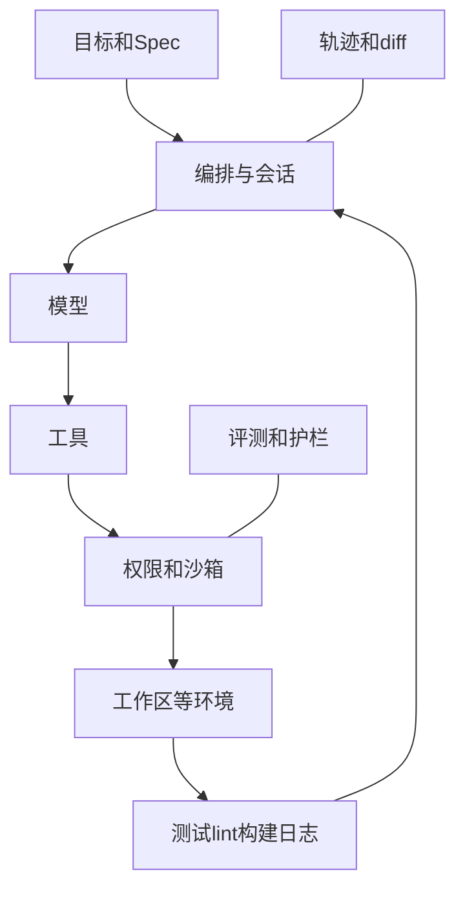

# Harness 工程

Harness 可以理解成包在模型外面的那一层：能调哪些工具、权限多大、测试结果怎么喂回来、出了问题能不能复盘、有没有基本护栏。Prompt 提高「目标说对」的概率；Harness 提高「稳定交出正确改动」的概率。

讨论 Agent 时，常把模型和这层外壳分开看：模型负责推理，外壳负责让结果在真实环境里可控地发生。

## 一、核心概念

### 1.1 为什么换更强模型替代不了这层

裸模型只会往外吐内容。一旦能改文件、跑命令、上网，就得回答：

| 问题 | 外壳弱时 | 外壳跟上时 |
| --- | --- | --- |
| 能调什么？ | 往往默认很全能 | 工具和权限说清楚 |
| 做错怎么发现？ | 靠人眼 | 测试 / 类型检查自动回灌 |
| 怎么止损？ | 改烂了才发现 | 确认、沙箱、可回滚 |
| 怎么知道变好了？ | 感觉 | 固定几道题前后对比 |
| 怎么复盘？ | 只剩最终 diff | 还能看到中间调用和失败 |

模型决定一部分上限；外壳决定这些能力有多少能安全变成日常生产力。

### 1.2 大概由哪些部分组成



| 部分 | 干什么 | 常见落地 |
| --- | --- | --- |
| 编排 | 多步怎么走、何时停、何时要人确认 | Agent 循环、Plan 确认 |
| 工具 | 读改搜、终端、浏览器、MCP | IDE / CLI Agent |
| 权限和沙箱 | 允许、拒绝、需确认 | 命令审批、只读、网络隔离、路径限制 |
| 反馈 | 客观信号送回去 | test / tsc / lint、CI |
| 可观测 | 失败能查、行为能追 | 工具轨迹、会话、diff |
| 评测和护栏 | 量一量、拦一拦 | 小回归集、密钥扫描、禁推远程 |

### 1.3 和 Prompt / Context / Spec 的分工

| | 主要管 | 出问题时常表现为 |
| --- | --- | --- |
| Prompt | 意图清不清 | 做了别的事 |
| Context | 信息对不对、够不够 | 改错地方、违反惯例 |
| Spec | 怎样算对 | 「做完了」却一直扯皮 |
| Harness | 能不能重复、约束、改进 | 偶尔成功、出事、改了也不知道变没变好 |

### 1.4 反馈环

```text
假设 → 调工具 → 环境变了 → 用测试/类型/运行看结果 → 形成新假设
```

没有观测，就只是开环生成代码。观测太吵（巨长未裁日志），闭环也会糊。裁剪方式见 Context 那篇。

## 二、怎么做

### 2.1 按性价比往上加，别一上来自研评测平台

1. 每个任务写清验收命令：`yarn test X`、`pnpm typecheck`，或关键手工步骤。  
2. 让 Agent 自己跑检查并读输出，少做人肉传话。  
3. 干净分支、小步提交；危险命令要确认；别在脏工作区上连续盲改。  
4. 默认只给读写工作区和跑测试；网络、推送、生产配置要显式升高。  
5. 限制可改路径；拒绝明显危险命令（乱删、改生产密钥、`git push --force` 等）。  
6. 固定几道到十几道代表性题，改 Rules / 工具后再跑，看成功率和有没有越界。  
7. 出事时能回答：调了什么、改了什么、从哪步开始偏。  

### 2.2 权限可以分层想

| 级别 | 大致允许 | 场景 |
| --- | --- | --- |
| 只读 | 读文件、搜索 | 问问题、审计 |
| 写工作区 | 改代码、跑本地测试 | 日常开发 |
| 受控命令 | 装依赖、部分网络 | 要确认 |
| 高风险 | 推远程、云资源、生产配置 | 默认拒绝或人来 |

权限跟任务绑定，别跟「我信这个模型」绑定。模型越强，越要假设它也会很自信地做错。

### 2.3 验收写进任务里

弱：

```text
做好了告诉我
```

强：

```text
完成后跑：
- yarn test src/pages/UserList
- yarn tsc --noEmit
把关键通过/失败输出贴出来。失败就修到过，或说明卡在哪。
```

### 2.4 小评测怎么才有用

不是拍个演示视频，而是固定题 + 固定怎么打分。可以看：

- 验收过不过 / Spec 条目满不满足  
- 步数、耗时、人插手几次  
- 有没有改白名单外的文件、有没有偷偷加禁止的依赖  
- 抽几单人审，看漏了什么  

题可以从真实修过的 bug（脱敏）、标准小功能、「应该拒绝」的危险请求里来。改完 Rules 或权限，用同一批题比；没有对比，就只是「感觉更好」。

### 2.5 护栏：能自动拦的，别只靠口头

| 口头 | 更靠谱一点 |
| --- | --- |
| 「别提交密钥」 | pre-commit 扫密钥 |
| 「小心生产库」 | 根本不给生产凭证；网络默认关 |
| 「请写测试」 | CI 不过不让合 |
| 「别大重构」 | 限制可改路径，单次改动别铺太大 |

很多进步，其实就是把「请注意」变成检查和策略。

### 2.6 个人一周内能先做到的

- README / `AGENTS.md` 写清测试和类型检查命令  
- 默认在独立分支上让 Agent 干活  
- 任务描述里带验收命令  
- push、删除、改环境变量类操作保持确认  
- 随手记几道常做题的成败  

这些就已经比「只会聊天改代码」稳一截。

## 三、常见坑

- 只换模型，外壳不变，出事模式也不变。  
- 工具加得越多，误操作面越大。  
- 看不见中间过程，只能对着烂结局干瞪眼。  
- 评测做一次演示就丢了，改提示词却证明不了变好。  
- 人在中间当总线传日志，反馈环断着。  
- 图省事把推送、生产权限打开，埋雷。  
- 沙箱严到全靠人手代跑，外壳等于摆设——该调策略，不是整层扔掉。  
