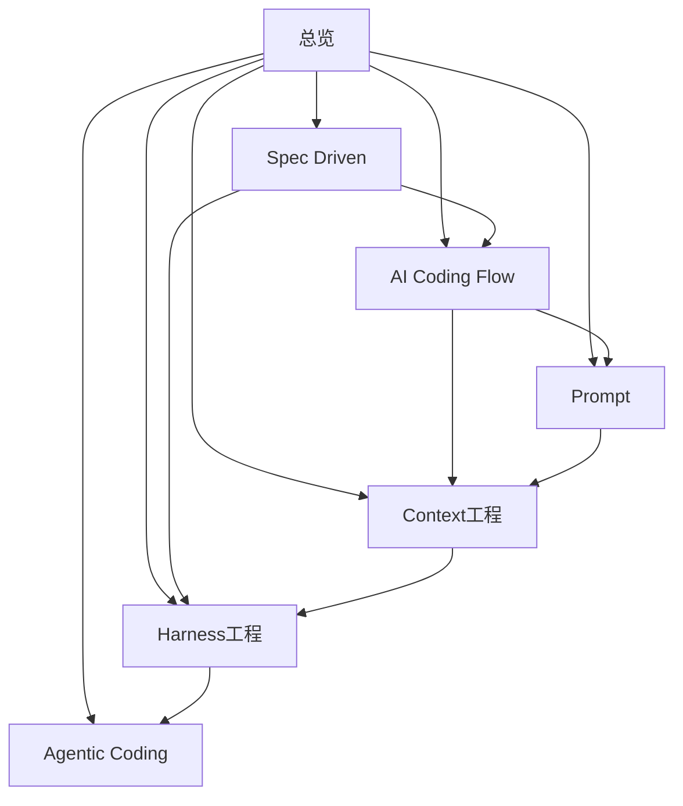

# AI Coding 总览

这组笔记整理 AI Coding 里比较主流的几块：工作流、Prompt、Context、Harness、Spec、Agent。重点不在某个 IDE 的按键，而在换工具之后还能用的判断方式。

## 一、核心概念

### 1.1 别把「模型变强」和「交付变稳」混为一谈

用起来不顺，经常不是模型不够聪明，而是下面几层没理清：

| 层 | 管什么 | 主要靠什么 |
| --- | --- | --- |
| 模型层 | 推理、生成、选工具 | 模型本身 |
| 交互层 | 意图清不清、信息够不够 | Prompt、Context、会话怎么管 |
| 系统层 | 能不能重复做、做错了能不能发现 | Flow、Spec、Harness、权限、测试 |

交互层出问题：目标糊、上下文噪声大、一个对话拖太久。  
系统层出问题：没有验收命令、没法回滚、权限给太大。

### 1.2 演进大致是这样

| 阶段 | 常见形态 | 人和 AI | 好处 | 风险 |
| --- | --- | --- | --- | --- |
| 补全 | IDE 行内建议 | 人写，AI 加速 | 少敲字 | 局部错不易察觉 |
| 对话 | Chat / 选中代码问 | 人问，AI 解释或给片段 | 理解快、草稿快 | 片段和仓库对不上 |
| Agent | 读仓、改文件、跑命令 | 人定目标，AI 连着干 | 定位到实现更快 | 错的也会进仓库 |
| Spec / Harness | 先规格，再工具和检查兜底 | 人定对错标准 | 可重复、好协作 | 有流程成本；规格会过期 |

越让 AI 直接改环境，就越要把「怎样算对」和「做错了怎么发现」说清楚。

### 1.3 这几篇怎么串起来

- [Flow](./ai-coding-flow.md)：这一轮怎么跟 AI 协作  
- [Prompt](./prompt.md)：怎么把意图说清楚  
- [Context](./context-engineering.md)：给它看什么、项目约定怎么挂  
- [Harness](./harness.md)：工具、权限、测试反馈怎么兜住  
- [Spec](./spec-driven.md)：怎样算做对  
- [Agentic](./agentic-coding.md)：单 Agent / 多角色怎么用  

### 1.4 几个词

| 词 | 意思 | 容易误会成 |
| --- | --- | --- |
| Flow | 协作怎么走、模式怎么选 | 一直开着 Agent 就算有 Flow |
| Prompt | 这轮明确指令 | 形容词越多越好 |
| Context | 它能用到的信息和约束 | 塞得越多越好 |
| Harness | 包在模型外面的工程手段 | 换个强模型就等于有了 |
| Spec | 能验收的成功标准 | 写了很长文档就是 Spec |
| Agent | 能调工具、能改环境的代理 | 多开几个窗口就是多 Agent |

做任务时其实在盯两件事：结果对不对（Spec、测试、可观察行为），过程乱不乱（改了多少、能不能审、能不能回滚）。结果勉强对、过程一团乱，后面很难收场；流程很完整、结果标准却糊，也白搭。

## 二、怎么用

### 2.1 建议阅读顺序

1. 这篇  
2. [AI Coding Flow](./ai-coding-flow.md)  
3. [Prompt](./prompt.md)、[Context 工程](./context-engineering.md)  
4. [Spec Driven](./spec-driven.md)、[Harness 工程](./harness.md)  
5. [Agentic Coding](./agentic-coding.md)  

如果已经会让 Agent 改代码，但返工很多，可以直接从 Spec 和 Harness 看起。

### 2.2 动手前先对齐这四样

1. 目标：一句话说完要干什么  
2. 边界：这次不做什么、别动哪里  
3. 上下文：相关模块、可以照着写的现有代码、关键约定  
4. 验收：命令、用例，或点一下能看出来的行为  

缺一两项时，Agent 越能干活，往往偏得越远。

### 2.3 任务难度不同，准备可以不同

| 任务 | 大概准备到什么程度 |
| --- | --- |
| 改文案、已知单点修复 | Prompt + 必要文件就行 |
| 单模块功能 | 再加验收步骤和测试命令 |
| 跨模块、有接口约定 | 先写清 Spec，再 Plan，再让 Agent 写 |
| 高风险、以后还要反复做 | Spec 写细一点，权限和回归检查跟上 |

### 2.4 大致处在哪一档

| 档 | 常见表现 |
| --- | --- |
| 只会补全、随口问一句 | 刚起步 |
| Prompt 能写清楚，验收还靠感觉 | 常用 Chat/Agent，但不稳 |
| 会先摸清/规划再改，有验收命令 | 开始像工程协作 |
| 复杂活有 Spec，Rules/约定有分层 | 团队也能复用 |
| 权限、反馈、简单回归、出问题能复盘 | 比较完整 |

笔记主要帮你把中间几档补齐。

## 三、常见坑

- 只学快捷键，工具一换又从零开始；能带走的是 Flow / Spec / Harness 这类判断。  
- 以为 Prompt 写好就够了：相关文件没给、测试没跑，模型还是在猜。  
- 复杂需求不写清验收：聊得越久，隐含目标越多，最后谁也说不清算不算做完。  
- 一次让 Agent 改一大片：难审、难回滚、出错不知道从哪步开始。  
- 换更强模型掩盖流程问题：短期好看，权限事故和漏测还在。  
- Rules / Spec 过期了还继续喂给模型：等于正式告诉它错误前提。  
