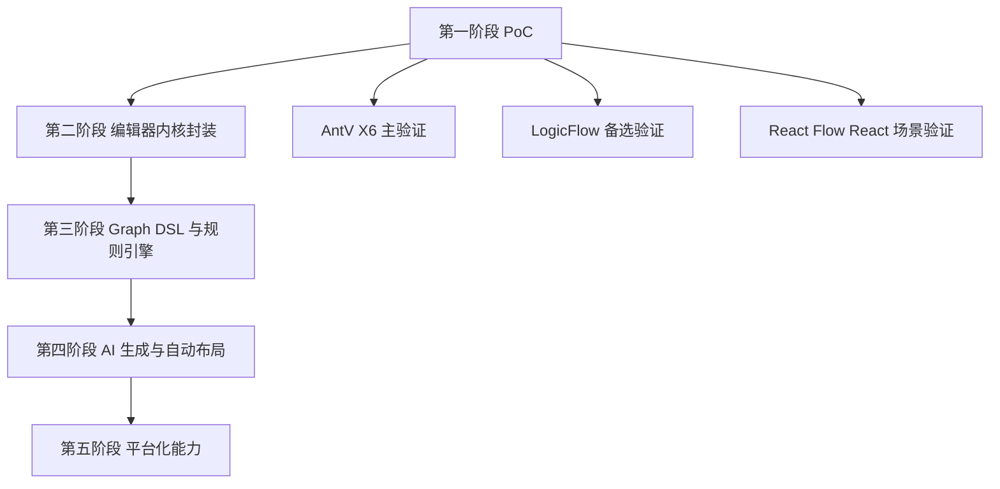

# 架构图编辑器平台技术选型报告

更新时间：2026-07-19  
适用范围：面向 Web 端架构图、流程图、关系图与 AI 辅助生成/编辑的图编辑器平台底座选型。

## 1. 执行摘要

若目标是搭建“可商用、可深度定制、支持复杂节点与连线规则、后续可接入 AI 生成/修改”的通用架构图编辑器平台，建议优先选择 **AntV X6** 或 **LogicFlow** 作为编辑器底座。

- **首选建议：AntV X6**。适合复杂图编辑、DAG、ER、血缘、流程、拓扑等通用图编辑场景，自定义能力强，生态成熟，对专业架构图平台适配度最高。
- **强备选：LogicFlow**。Apache-2.0 许可更适合企业合规，流程图编辑能力完整，官方插件、布局包和随 npm 发布的本地文档对 AI 编码与自动化开发更友好。
- **React 技术栈强绑定时：React Flow 可作为强备选**。它的 React 组件化体验、社区规模和文档质量突出，但更偏“节点式 UI 框架”，构建专业图编辑器时需要补足规则引擎、插件、图模型治理等能力。
- **BPMN 标准流程建模：选择 bpmn.js**。它是 BPMN 2.0 专项工具，不建议作为通用架构图编辑器底座。
- **大规模关系分析/可视化：选择 AntV G6 或 Cytoscape.js**。它们更适合图可视化和分析，不是完整编辑器平台的主底座。

结论：如果平台定位是企业级架构图编辑器，建议以 **AntV X6 为主方案，LogicFlow 为合规与流程编辑备选，React Flow 为 React 场景备选**；后续通过 2-3 周 PoC 验证节点 DSL、AI 生成图 JSON、自动布局、导入导出、权限协同和大图性能。

## 2. 项目背景与选型目标

架构图编辑器平台不是简单的“画布 + 拖拽节点”，它通常需要承载以下能力：

- 图元建模：系统、服务、数据库、消息队列、网关、外部依赖等节点类型。
- 连线语义：调用、依赖、数据流、部署关系、控制流、事件流等边类型。
- 画布交互：拖拽、缩放、吸附、对齐、框选、撤销重做、复制粘贴、快捷键。
- 规则约束：节点连接规则、类型校验、图结构校验、环路检测、命名规范。
- 数据协议：可序列化的 JSON/DSL，便于存储、版本管理、审计、导入导出。
- AI 能力：根据自然语言生成图、修改局部图、解释图、检查架构风险、自动布局。
- 平台能力：模板、权限、协同、评审、发布、快照、图片/SVG/JSON 导出。

因此选型需要同时关注图编辑能力、商业许可、生态成熟度、AI 适配性与长期维护成本。

## 3. 评估维度与权重

| 维度 | 权重 | 评估重点 |
| --- | ---: | --- |
| 商业可用性 | 15 | 开源协议、商用限制、水印/署名要求、合规风险 |
| 社区活跃度 | 15 | GitHub stars、issues、发布频率、维护组织、生态规模 |
| 文档健全性 | 10 | 官方文档、API、示例、中文资料、迁移指南 |
| 架构图平台适配度 | 20 | 节点/边自定义、画布交互、插件、规则、导入导出 |
| AI 适配性 | 15 | 结构化图模型、机器可读文档、自动布局、语义校验 |
| 开发难易程度 | 15 | 上手成本、框架绑定、类型支持、二次开发复杂度 |
| 性能与扩展 | 10 | 大图能力、渲染模式、布局算法、插件生态、维护风险 |

评分采用 10 分制并按权重折算为百分制。分数用于辅助决策，不代表绝对优劣，最终仍需结合产品定位与团队技术栈。

## 4. 候选库总览

| 库 | 定位 | 许可 | 商用判断 | 推荐等级 |
| --- | --- | --- | --- | --- |
| AntV X6 | 通用图编辑与可视化引擎 | MIT | 可商用 | 首选 |
| LogicFlow | 业务流程图/图编辑框架 | Apache-2.0 | 可商用，合规友好 | 强备选 |
| React Flow | React 节点式 UI/流程编辑 | MIT | 可商用，隐藏署名建议订阅 Pro | React 场景强备选 |
| bpmn.js | BPMN 2.0 渲染与建模 | bpmn.io License | 可商用但必须保留水印 | BPMN 专项 |
| AntV G6 | 图可视化/分析引擎 | MIT | 可商用 | 可视化/分析层 |
| Cytoscape.js | 图论分析与网络可视化 | MIT | 可商用 | 大规模关系分析 |
| Rete.js | 可视编程/数据流编辑器 | MIT | 可商用 | AI 工作流/数据流 |
| JointJS | 通用图编辑库 | MPL-2.0 | 可商用，修改原库文件需开源 | 需合规评估 |
| Drawflow | 轻量数据流编辑器 | MIT | 可商用 | MVP/低复杂度 |
| GoJS | 商业图编辑库 | 商业许可 | 需付费授权 | 商业对照，不作为开源主选 |

## 5. 多维评分矩阵

| 库 | 商业可用 | 社区活跃 | 文档 | 平台适配 | AI 适配 | 开发难度 | 性能扩展 | 综合分 |
| --- | ---: | ---: | ---: | ---: | ---: | ---: | ---: | ---: |
| AntV X6 | 9.5 | 8.5 | 9.5 | 9.5 | 8.5 | 8.5 | 9 | 90.0 |
| LogicFlow | 10 | 8 | 9 | 8.5 | 9 | 8.5 | 8 | 87.3 |
| React Flow | 9 | 10 | 10 | 7.5 | 8 | 9 | 8 | 86.0 |
| AntV G6 | 10 | 8.5 | 9 | 6.5 | 7.5 | 7 | 9 | 80.8 |
| Cytoscape.js | 10 | 9 | 9 | 5.5 | 7.5 | 6.5 | 9 | 78.3 |
| JointJS | 7.5 | 7 | 8.5 | 8 | 7 | 7.5 | 8 | 75.8 |
| Rete.js | 10 | 8 | 8 | 5.5 | 8.5 | 6.5 | 8 | 75.3 |
| bpmn.js | 7 | 8.5 | 9 | 5.5 | 7 | 6.5 | 8 | 73.5 |
| Drawflow | 9.5 | 6 | 6 | 4 | 5 | 8 | 6 | 62.3 |
| GoJS | 4 | 8 | 10 | 9 | 7 | 8.5 | 9 | 76.3 |

说明：

- GoJS 功能成熟，但不是开源方案，综合分仅作为商业闭源标杆参考。
- AntV X6 综合分最高，主要来自平台适配度、文档完整性和复杂图编辑扩展能力。
- React Flow 综合分高，主要来自社区、文档和 React 体验；但架构图平台所需的规则、插件体系、复杂图语义需要更多自研。
- LogicFlow 与 X6 更贴近“图编辑器底座”而非单纯可视化库。

## 6. 重点候选分析

### 6.1 LogicFlow

LogicFlow 是滴滴开源的流程图编辑框架，定位为“专注于业务自定义的流程图编辑框架”，支持流程图、脑图、ER 图、UML、工作流等编辑场景。核心包为 `@logicflow/core`，官方还提供 `@logicflow/extension` 和 `@logicflow/layout`。

优势：

- Apache-2.0 许可，企业商用和二次开发合规友好。
- 面向业务流程编辑，节点、边、事件、主题、插件、布局能力较完整。
- 中文资料和国内实践较多，团队学习成本相对可控。
- 从 `@logicflow/core@2.2.2` 起随 npm 包发布本地文档，对 AI Agent 读取官方资料、生成代码和减少幻觉很有帮助。
- 图数据结构清晰，适合设计平台自己的架构图 DSL，并让 LLM 生成/修改 JSON。

不足：

- 相比 React Flow，国际社区与生态规模较小。
- 复杂交互或高度定制 UI 仍需要理解内部模型、事件和插件机制。
- 如果目标包含大量非流程类图形表达，需要提前验证图元自定义边界。

适用场景：

- 企业架构图、业务流程图、系统依赖图、服务编排图、审批流、工作流。
- 希望兼顾开源合规、中文生态、AI 编码辅助和平台化扩展。

建议定位：**强备选方案**。

### 6.2 AntV X6

AntV X6 是 AntV 体系下的图编辑和可视化引擎，基于 HTML/SVG，适用于 DAG、ER 图、流程图、血缘图、拓扑图等场景。X6 具有较强的通用图编辑能力和深度定制能力。

优势：

- MIT 许可，商用友好。
- 图编辑能力成熟，适合复杂节点、端口、边、锚点、路由、插件和交互定制。
- AntV 生态完整，可与 G6、布局、数据可视化体系形成组合。
- 适合构建复杂架构图、拓扑图、数据血缘和专业建模工具。
- 在平台适配度、复杂图表达和扩展性上综合表现最好，因此综合评分最高。

不足：

- 能力强意味着工程复杂度也更高，团队需要更深入理解图模型与渲染机制。
- 对 AI 的“本地机器可读文档”支持不如 LogicFlow 明确，需要自行沉淀代码模板和 DSL 约束。
- 若只做简单节点式流程，可能显得偏重。

适用场景：

- 通用架构图编辑器、云资源拓扑、数据血缘、复杂连线规则、专业图建模工具。

建议定位：**主推荐方案**。

### 6.3 React Flow

React Flow 是 xyflow 团队维护的 React 节点式 UI 库，社区规模和文档质量非常突出，适合快速构建自定义节点、流程编排、AI 工作流和低代码画布。

优势：

- MIT 许可，商用友好；官方说明隐藏默认 attribution 时建议订阅 React Flow Pro，但 MIT 许可本身不强制保留。
- React 组件化体验非常好，节点 UI 可直接复用业务组件。
- 文档、示例、社区和生态成熟，招聘和团队上手成本低。
- 对 LLM 生成图数据较友好，节点和边模型直接、可序列化。

不足：

- 更偏节点式 UI 框架，不是完整专业图编辑器内核。
- 复杂连线规则、图语义约束、自动布局、版本治理、插件体系需要较多自研或集成第三方能力。
- 如果平台未来不绑定 React，技术栈耦合较强。

适用场景：

- React 技术栈、AI Agent 工作流、低代码流程编排、产品原型和中等复杂度架构图。

建议定位：**React 栈强备选**。

### 6.4 bpmn.js

bpmn.js 是 bpmn.io/Camunda 生态下的 BPMN 2.0 渲染与建模工具，适合标准 BPMN 流程建模。

优势：

- BPMN 2.0 标准支持完整，适合严肃流程建模、流程引擎集成和标准 XML 交换。
- 文档、示例和论坛资料较丰富。
- 可嵌入浏览器应用，无需后端即可完成建模。

不足：

- bpmn.io License 要求保留 bpmn.io 水印，不能移除或遮挡。对追求完全品牌化的商业产品是明确限制。
- 定位高度垂直，不适合作为通用架构图、拓扑图或云资源图的主底座。
- 自定义 BPMN 外图元时会受到标准语义和内部架构约束。

适用场景：

- BPMN 标准流程设计器、流程引擎建模、审批/编排系统中的 BPMN 子模块。

建议定位：**BPMN 专项模块，不作为通用主底座**。

## 7. 补充候选与排除理由

### AntV G6

G6 是图可视化与分析引擎，布局、交互、图分析能力强，MIT 许可，生态成熟。它适合关系网络、依赖分析、知识图谱、拓扑展示和大图探索。若架构图平台需要“分析视图”或“大图只读视图”，G6 很适合；但作为编辑器底座，需要自研较多编辑交互与业务规则。

### Cytoscape.js

Cytoscape.js 是成熟的图论与网络可视化库，MIT 许可，npm 下载量和科研/工业应用基础很强。它适合大规模关系网络、图算法、服务依赖分析和知识图谱浏览，但并非面向专业图编辑器的开箱框架。若要做架构关系分析层，可以作为补充技术。

### Rete.js

Rete.js 是面向可视编程和数据流的 TypeScript-first 框架，适合 AI 工作流、规则编排、节点计算图和可视化代码生成。它不适合通用架构图表达，但如果平台未来要扩展“AI 工作流编排器”，Rete.js 是值得单独评估的候选。

### JointJS

JointJS 是历史悠久的通用图编辑库，功能成熟，商业产品实践较多。开源版本采用 MPL-2.0，允许商用，但对修改原库文件有文件级 copyleft 要求；高级能力通常在 JointJS+ 商业版本中。若企业能接受 MPL 合规和商业授权模式，可作为成熟方案评估。

### Drawflow

Drawflow 是轻量数据流编辑库，MIT 许可，上手快、体积小、依赖少，适合 MVP 或简单流程编辑。但文档、维护活跃度、复杂交互、类型体系和平台扩展能力不足，不建议作为长期企业级架构图平台底座。

### GoJS

GoJS 是非常成熟的商业图编辑库，功能、文档、性能和企业支持都很强，但不是开源软件。生产使用通常需要购买授权并配置 license key。它适合作为“付费省研发成本”的商业对照，不符合本报告“主流开源图编辑库”优先的选型目标。

## 8. 场景匹配建议

| 场景 | 最佳选择 | 备选 | 原因 |
| --- | --- | --- | --- |
| 通用架构图编辑器 | AntV X6 | LogicFlow | 复杂图编辑与平台适配能力最强，综合评分最高 |
| 复杂拓扑/血缘/专业图建模 | AntV X6 | LogicFlow | 图编辑定制能力强，适合复杂端口、路由和连线规则 |
| React 产品快速落地 | React Flow | LogicFlow | 组件化开发快，生态大，适合业务节点 UI |
| BPMN 标准流程设计 | bpmn.js | GoJS | 标准兼容度高，但需保留水印 |
| AI 工作流/数据流编排 | React Flow 或 Rete.js | LogicFlow | 节点/边数据结构简单，适合 LLM 生成与修改 |
| 关系网络分析/大图展示 | G6 或 Cytoscape.js | X6 | 布局、分析、大图可视化能力更强 |
| 轻量 MVP | React Flow 或 Drawflow | LogicFlow | 上手快，但长期平台能力需谨慎 |

## 9. AI 适配性专项分析

AI 适配的关键不是库是否“支持 AI”，而是它是否能稳定承载 LLM 生成、校验、修改和解释图结构。

建议为平台设计独立 DSL，而不是直接暴露底层库格式：

```json
{
  "nodes": [
    {
      "id": "api-gateway",
      "type": "gateway",
      "label": "API Gateway",
      "properties": {
        "owner": "platform",
        "runtime": "nginx"
      }
    }
  ],
  "edges": [
    {
      "id": "edge-1",
      "source": "api-gateway",
      "target": "order-service",
      "type": "http",
      "label": "REST"
    }
  ],
  "layout": {
    "direction": "LR"
  }
}
```

AI 适配评估：

- **AntV X6**：最适合复杂架构图生成与深度定制。建议封装中间 DSL，避免 LLM 直接生成过多 X6 专有配置。
- **LogicFlow**：最适合 AI 编码辅助。官方 npm 包内置本地文档，图数据结构清晰，容易生成“受约束 JSON + 校验 + 渲染”链路。
- **React Flow**：节点和边模型简单，LLM 生成容易，但复杂架构语义、连线规则和布局需平台自研。
- **bpmn.js**：若 AI 生成 BPMN XML，需要更强的 schema 校验和标准知识约束，适合专项而非通用图。
- **G6/Cytoscape.js**：适合 AI 生成关系网络和分析视图，不适合作为编辑工作流主底座。
- **Rete.js**：适合 AI Agent 工作流和可执行数据流图，适合作为独立子产品。

建议 AI 架构：


## 10. 推荐方案

### 10.1 主方案：AntV X6 + 平台自定义 DSL

推荐技术路线：

- 图编辑底座：AntV X6。
- 数据协议：平台自定义 Graph DSL，不直接把底层库数据作为业务存储协议。
- 布局能力：优先使用 X6 生态布局能力，复杂场景可接入 Dagre/ELK 等布局算法。
- AI 能力：LLM 生成 Graph DSL，后端或前端执行 schema 校验、连接规则校验和自动布局。
- 上层平台：模板、版本、权限、审计、导入导出、图片导出、团队协同由业务层实现。

适合原因：

- 通用架构图、拓扑图、血缘图和复杂连线规则适配最好。
- 图编辑定制能力和扩展性最强，综合评分最高。
- 可与 AntV G6 等分析视图形成组合。
- MIT 许可商用友好，适合作为长期底座。

主要风险：

- 工程复杂度高于 LogicFlow，需要预留学习与封装成本。
- AI 本地机器可读文档不如 LogicFlow 明确，需自行沉淀 DSL 模板与校验规则。
- 若团队更看重 Apache-2.0 合规叙事，LogicFlow 仍是强备选。

### 10.2 备选方案：LogicFlow + 流程编辑增强

适用于以下前提：

- 更强调业务流程编辑、中文生态和 AI 编码辅助。
- 希望 Apache-2.0 许可带来更稳妥的企业合规表达。
- 图元复杂度中等，优先追求开发效率和插件完备度。

建议将 LogicFlow 封装为渲染适配层，上层仍使用平台 Graph DSL，避免业务逻辑强耦合底层格式。

### 10.3 React 方案：React Flow + 自研规则层

适用于以下前提：

- 前端技术栈明确为 React。
- 产品强调自定义节点 UI、AI 工作流、快速迭代。
- 团队愿意自研图规则、插件、布局、导入导出和平台能力。

React Flow 非常适合中短期快速落地，但如果目标是专业架构建模平台，应提前规划模型层和规则层，避免后期陷入“画布能画，但平台难管”的状态。

## 11. 风险与规避策略

| 风险 | 影响 | 规避策略 |
| --- | --- | --- |
| 许可不清 | 商业发布受阻 | 优先 MIT/Apache-2.0；bpmn.js 保留水印；JointJS 做 MPL 合规审查 |
| 底层格式耦合 | 后续迁移困难 | 设计平台 Graph DSL，图编辑库只做渲染和交互适配 |
| AI 生成不稳定 | 图结构错误、无法渲染 | 使用 JSON Schema、类型枚举、连接规则、自动修复和布局兜底 |
| 大图性能不足 | 画布卡顿 | PoC 测试 500/2000/5000 节点；区分编辑视图和分析视图 |
| 复杂图元定制超预期 | 工期膨胀 | 先验证端口、连线规则、分组、嵌套、标签、快捷键 |
| 文档和社区不足 | 维护风险 | 优先官方活跃项目；沉淀内部示例、组件库和开发规范 |
| 协同能力缺失 | 多人编辑难实现 | 第一阶段做版本/锁定/评论，实时协同另做专项技术验证 |

## 12. PoC 验证清单

建议用 2-3 周完成 PoC，避免只看 demo 做决策。

### 基础编辑能力

- 创建、拖拽、删除、复制、粘贴节点。
- 创建不同类型连线，支持箭头、标签、折线/曲线。
- 节点端口、锚点、连接规则和非法连接提示。
- 框选、多选、对齐、吸附、撤销重做、快捷键。
- 画布缩放、拖拽、迷你地图、适配屏幕。

### 平台化能力

- 平台 Graph DSL 与底层库数据互转。
- JSON 导入导出、PNG/SVG 导出。
- 模板加载、图元面板、属性面板。
- 节点类型 schema、边类型 schema、规则校验。
- 版本快照与 diff 的可行性。

### AI 能力

- 自然语言生成 10 节点以内架构图。
- 修改局部图：新增服务、替换数据库、增加缓存、删除依赖。
- 对图做架构风险解释：单点、循环依赖、跨域调用、命名不规范。
- LLM 输出 JSON Schema 校验、错误修复和自动布局。

### 性能能力

- 100、500、2000 节点编辑体验。
- 5000 节点只读展示体验。
- 布局耗时、首次渲染耗时、交互帧率。
- 大量边、标签、端口下的性能表现。

## 13. 最终建议

综合商业可用性、平台适配度、AI 适配性和开发成本，本报告建议：

1. **优先 PoC AntV X6**：作为企业级架构图编辑器的主底座候选。
2. **并行小范围 PoC LogicFlow**：验证流程编辑体验、AI 本地文档辅助和企业合规适配。
3. **若前端强绑定 React，再 PoC React Flow**：用于比较开发效率和自定义节点体验。
4. **bpmn.js 只作为 BPMN 子模块评估**：不要把它作为通用架构图平台底座。
5. **G6/Cytoscape.js 作为分析视图补充**：用于大图关系分析、拓扑浏览和知识图谱视图。

推荐落地路线：



短期最优解是 **AntV X6 + 平台 Graph DSL + AI 校验/布局层**。  
中长期应保持底层图编辑库可替换，将业务模型、权限、版本、AI 规则和导入导出能力沉淀在平台层，而不是沉淀在某个库的私有数据结构里。

## 14. 关键事实来源

- AntV X6：GitHub 仓库 `antvis/X6`，MIT License，官方文档 `https://x6.antv.antgroup.com`。
- LogicFlow：GitHub 仓库 `didi/LogicFlow`，Apache-2.0 License，官方文档 `https://site.logic-flow.cn`；`@logicflow/core` npm 包说明自 2.2.2 起包含本地文档，2.2.3 于 2026-05 发布。
- bpmn.js：GitHub 仓库 `bpmn-io/bpmn-js`；bpmn.io License 要求保留并不得遮挡 bpmn.io watermark。
- React Flow / xyflow：GitHub 仓库 `xyflow/xyflow`，MIT License，官方文档 `https://reactflow.dev`；官方 attribution policy 表示 MIT 不强制保留署名，但隐藏 attribution 建议订阅 Pro。
- AntV G6：GitHub 仓库 `antvis/G6`，MIT License，官方文档 `https://g6.antv.antgroup.com`。
- Cytoscape.js：GitHub 仓库 `cytoscape/cytoscape.js`，MIT License，官方文档 `https://js.cytoscape.org`。
- Rete.js：GitHub 仓库 `retejs/rete`，MIT License，官方文档 `https://retejs.org`。
- JointJS：GitHub 仓库 `clientIO/joint`，MPL-2.0 License；JointJS+ 为商业增强版。
- Drawflow：GitHub 仓库 `jerosoler/Drawflow`，MIT License。
- GoJS：官方部署与授权文档 `https://gojs.net/latest/intro/deployment.html`，说明其为商业许可软件，生产部署需授权和 license key。
